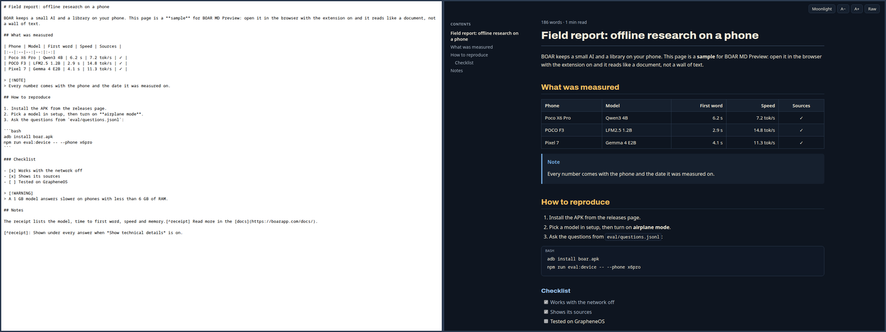
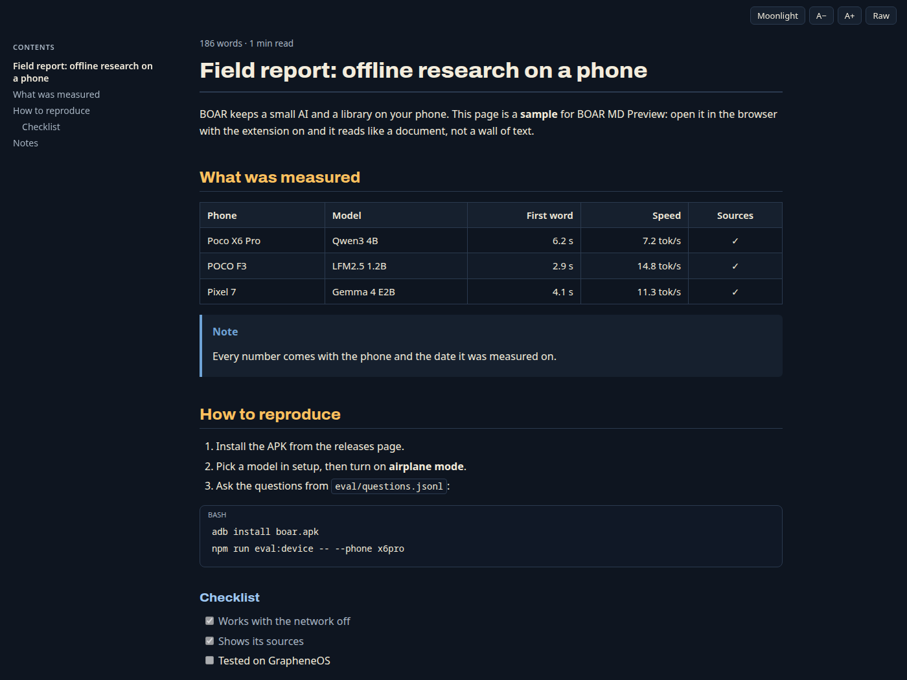
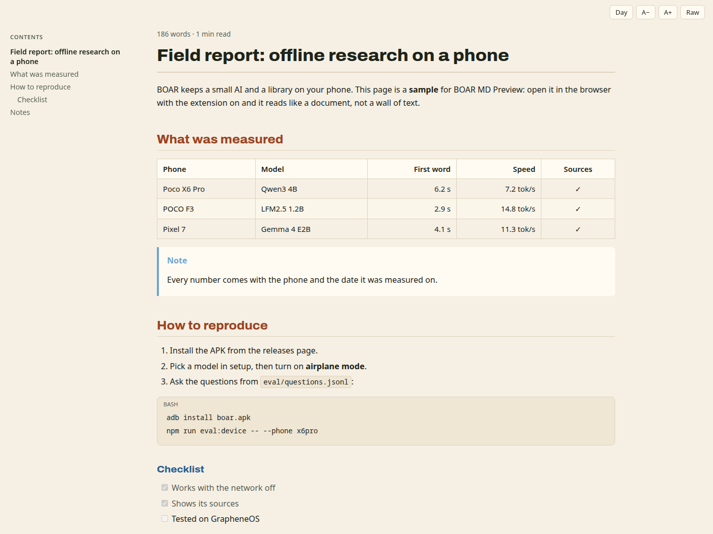
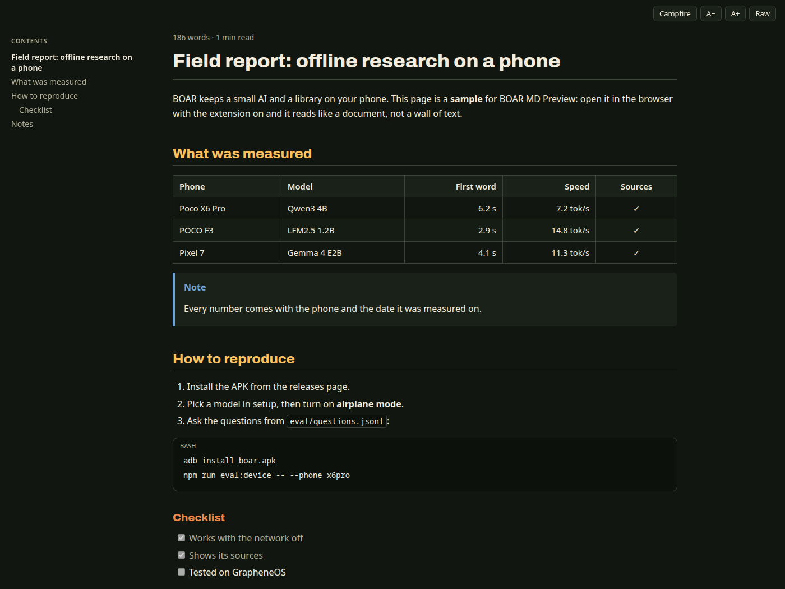
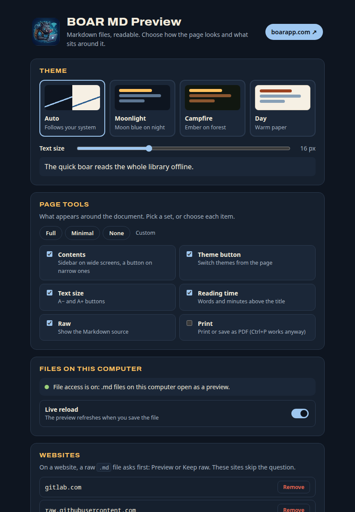

<p align="center">
  
</p>

<h1 align="center">BOAR MD Preview</h1>

<p align="center">
  Read Markdown files in your browser as clean pages: headings, tables, code, lists, alerts and footnotes.<br>
  Local files and raw <code>.md</code> on the web. No dependencies, no network calls, nothing leaves your browser.
</p>

<p align="center">
  
</p>

---

## What it does

Open a `.md` file in Brave, Chrome or Edge (`file:///…/report.md`, or a raw file on the web) and instead of a wall of text you get a page you can read:

| | |
|---|---|
| **Headings** | Real titles, a contents sidebar on wide screens, and a `#` on each heading that copies a link to it |
| **Tables** | Borders, alignment from the `:--:` row, striped rows, side scrolling when wide |
| **Code** | Code blocks with a language label and a Copy button; inline `code` stands out |
| **Lists** | Nested, numbered (keeps the start number) and task lists with checkboxes |
| **GitHub extras** | Alerts (`> [!NOTE]`, `[!TIP]`, `[!IMPORTANT]`, `[!WARNING]`, `[!CAUTION]`), footnotes, strikethrough, autolinks |
| **Reading** | Three themes, text size A− / A+, reading time, a Raw button for the source, and an optional Print button |
| **Live reload** | A local file refreshes on its own when you save it, keeping your place on the page |

### Themes

Colors come from BOAR's look: **Moonlight** (moon blue on night), **Campfire** (ember on forest) and **Day** (warm paper). **Auto** follows your system: Moonlight in dark mode, Day in light mode.

| Moonlight | Day | Campfire |
|---|---|---|
|  |  |  |

## Install

### From the Chrome Web Store

Coming soon.

### From this repository

1. Download or clone this repository.
2. Open `chrome://extensions` (Brave: `brave://extensions`, Edge: `edge://extensions`) and turn on **Developer mode**.
3. Click **Load unpacked** and choose the repository folder.
4. Open the extension's **Details** and turn on **Allow access to file URLs**. Without it the browser doesn't let any extension run on local files, so `.md` files on your disk stay as plain text.

Try it with [`docs/sample.md`](docs/sample.md).

## How it decides what to show

- It runs only on addresses that end in `.md` or `.markdown`. On every other page it is never loaded.
- Even there, it acts only when the browser shows the file as **plain text**. A website's own page whose address happens to end in `.md` (like a README page on github.com) is left alone.
- **Local files** render straight away.
- **On a website**, a bar asks first: **Preview** or **Keep raw**, with **Always preview on this site** to skip the question next time. You can remove sites from the list in the settings.

## Settings

Right-click the extension icon → **Options**. You decide what the page shows, not us:

- **Theme** (Auto, Moonlight, Campfire, Day) and **text size**, with a live sample
- **Page tools**: **Full**, **Minimal** (just the contents), **None** (only the document), or pick each item: contents, theme button, text size, reading time, Raw, Print
- **Files on this computer**: shows whether file access is on, with a button to turn it on, and live reload on or off
- **Websites** that always preview, with Remove

The theme and text size buttons on the page change the same settings.

<p align="center"></p>

## Privacy and permissions

BOAR MD Preview makes **no network requests**, collects nothing and has no analytics. It reads only the Markdown page in front of you, in your browser. Images that a Markdown file points to load the same way they would on any web page.

| Permission | Why |
|---|---|
| Access to `*.md` / `*.markdown` addresses | To render those pages. The browser may describe it as "read and change data on sites"; it applies only to Markdown addresses. |
| `storage` | To remember your theme, text size, live reload choice and the sites that always preview. Kept in your browser. |
| File URLs (you turn it on) | To render Markdown files from your disk. |

Markdown from the web is treated as untrusted: raw HTML is shown as text and never run, and links or images that use unsafe addresses (`javascript:`, `data:text/html`…) are not made clickable. See [PRIVACY.md](PRIVACY.md).

## Development

No build step and no dependencies: the extension is the files in this folder.

| File | What it is |
|---|---|
| `md.js` | The Markdown renderer: a pure function, no DOM, used by the page and by the tests |
| `content.js` | The page script: the Preview / Keep raw bar, layout, themes, tools, live reload |
| `style.css` | Themes and layout, scoped to the extension's own classes |
| `options.html`, `options.css`, `options.js` | The settings page |
| `test/md.test.js` | Renderer tests, including links and HTML a hostile file could try |

```bash
npm test        # node --test, needs Node 18 or newer
npm run pack    # writes dist/boar-md-preview-<version>.zip for the Chrome Web Store
node scripts/demo-page.js docs/sample.md moonlight > /tmp/demo.html   # a static preview page
```

The renderer covers the GitHub-flavoured Markdown people write day to day. It is not a full CommonMark implementation; if a file renders wrong, open an issue with the snippet.

## Credits

- Headings use [Archivo](https://github.com/Omnibus-Type/Archivo), bundled under the SIL Open Font License ([fonts/Archivo-OFL.txt](fonts/Archivo-OFL.txt)).
- Made by the [BOAR](https://boarapp.com/) team. BOAR keeps a small AI and a library of knowledge on your phone.

## License

[MIT](LICENSE)
